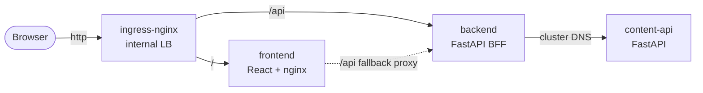

# Content Hub — the application

Three microservices that render a catalog of content. Built to run on the
private AKS cluster this repo provisions.



| Service       | Stack                    | Port | Exposed via ingress    | Talks to    |
| ------------- | ------------------------ | ---- | ---------------------- | ----------- |
| `frontend`    | React 18 + Vite → nginx  | 8080 | yes — `/`              | backend     |
| `backend`     | Python 3.12 + FastAPI    | 8000 | yes — `/api`           | content-api |
| `content-api` | Python 3.12 + FastAPI    | 8000 | **no** — ClusterIP     | nothing     |

## Why three services and not two

`content-api` owns the data and nothing else. `backend` is a
backend-for-frontend: it fans out to `content-api`, computes the presentation
fields (`reading_time_label`, `is_new`) and the aggregate stats, and caches the
result. That split is what makes the frontend able to stay dumb — it renders
exactly what it is handed — and lets the data model change without touching the
browser bundle.

The honest trade-off is one extra network hop per request. It buys a stable
client contract and one place to add fan-out, auth, or rate limiting later. On
a two-service design the frontend would have to do that aggregation itself, in
the client, over a public-shaped API.

## API contracts

**content-api** (internal only)

| Method | Path                    | Notes                                                     |
| ------ | ----------------------- | --------------------------------------------------------- |
| GET    | `/healthz` `/readyz`    | No dependencies — readiness mirrors liveness               |
| GET    | `/api/v1/items`         | `category`, `tag`, `q`, `limit` (1-100), `offset`          |
| GET    | `/api/v1/items/{id}`    | 404 when absent                                            |
| GET    | `/api/v1/categories`    | Name + item count                                          |
| GET    | `/docs`                 | OpenAPI UI                                                 |

**backend** (what the browser calls)

| Method | Path                     | Notes                                                          |
| ------ | ------------------------ | -------------------------------------------------------------- |
| GET    | `/healthz`               | Liveness — never touches content-api                            |
| GET    | `/readyz`                | Readiness — 503 if content-api is unreachable                   |
| GET    | `/api/v1/catalog`        | Enriched items + `stats` + `served_by` + `cache_hit`            |
| GET    | `/api/v1/catalog/{id}`   | Single enriched item                                            |
| GET    | `/api/v1/meta`           | Live service chain + categories + cache stats; degrades to 200  |

## The probe design is deliberate

`backend`'s **liveness** probe hits `/healthz`, which checks nothing external.
Its **readiness** probe hits `/readyz`, which does call `content-api`.

That asymmetry is the whole point. If liveness checked the dependency, a single
`content-api` outage would fail liveness on every `backend` pod at once and
Kubernetes would restart the entire fleet — turning a partial outage into a
total one. With this split, a `content-api` outage pulls `backend` pods out of
the Service endpoints, they keep running, and they recover on their own when
the dependency returns. Verified locally: stopping `content-api` gives
`/healthz` 200, `/readyz` 503, `/api/v1/catalog` 503, and `/api/v1/meta` 200
with `content-api: unreachable`.

## Running locally

```bash
docker compose -f apps/docker-compose.yml up --build
open http://localhost:8080
```

Same topology as the cluster, minus the ingress: nginx in the frontend
container proxies `/api` to the backend, so the browser only ever talks to one
origin — exactly as it does behind the internal ingress in AKS. No CORS
anywhere, and no build-time API URL baked into the bundle.

Also published for poking directly:

- <http://localhost:8000/docs> — content-api OpenAPI
- <http://localhost:8001/docs> — backend OpenAPI

To watch the degradation path:

```bash
docker compose -f apps/docker-compose.yml stop content-api
curl -s localhost:8001/healthz   # 200 — still alive
curl -s localhost:8001/readyz    # 503 — not ready
```

## Tests

```bash
cd apps/content-api && pip install -r requirements-dev.txt && pytest
cd apps/backend     && pip install -r requirements-dev.txt && pytest
```

23 tests. The backend suite mocks `content-api` with `respx` and covers the
retry-on-5xx path, cache hit/miss keying, the 503-not-500 translation when the
dependency is unreachable, and the liveness/readiness asymmetry above.

## Images

All three are multi-stage and run as a non-root numeric UID, which is what lets
the deployments set `runAsNonRoot`, `readOnlyRootFilesystem` and
`capabilities: drop: [ALL]` under the namespace's `restricted` Pod Security
Admission level.

- Python services: `python:3.12-slim` (not alpine — manylinux wheels for
  `pydantic-core` install straight off the shelf on glibc), UID 10001.
- Frontend: `nginxinc/nginx-unprivileged:1.27-alpine`, UID 101, listening on
  8080 so it needs no `CAP_NET_BIND_SERVICE`.

`APP_VERSION` is baked in at build time via `--build-arg`, so a pod can never
report a version that disagrees with the binary it is running.

See [k8s/README.md](../k8s/README.md) for the deploy runbook.
